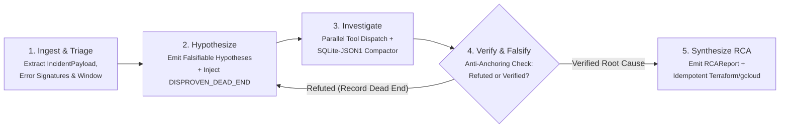

# 🚀 CloudOps Autonomous Troubleshooting & RCA Agent

> **Author**: Mario Hu (`@mariohu-fde`)  
> **Architecture**: Falsification-First 5-Node StateGraph · Negative-Knowledge (`DISPROVEN_DEAD_END`) Contracts · Zero-Bloat `SQLite-JSON1` Tool Compactor · Stage 2.5 Counterfactual Replay (`CF_Value`)

---

## 🏗️ 1. System Architecture

Standard single-loop ReAct troubleshooting agents fail on complex cloud incidents due to **Confirmation Bias (Hypothesis Anchoring)**, **Raw Telemetry Context Bloat**, and **Repeating Falsified Dead Ends**.

`cloudops-autonomous-agent` enforces a **Falsification-First 5-Node State Machine** backed by strict data contracts and out-of-band `SQLite-JSON1` telemetry compaction:



---

## 🧩 2. Core Engineering Modules (Implemented in Phase 1)

| Module | File Path | Architectural Problem Solved |
| :--- | :--- | :--- |
| **Incident & Negative-Knowledge Contracts** | [`src/cloudops_agent/schemas/incident.py`](src/cloudops_agent/schemas/incident.py) | Prevents hypothesis anchoring via `DisprovenDeadEnd` contracts and `[UNVERIFIED_HYPOTHESIS / FAILED_ATTEMPT]` prompt serialization. |
| **Zero-Bloat Tool Output Compactor** | [`src/cloudops_agent/middleware/tool_compactor.py`](src/cloudops_agent/middleware/tool_compactor.py) | Intercepts `>50KB` JSON telemetry dumps, stores raw logs in an out-of-band `SQLite-JSON1` cache, and returns a `<40` line Schema Skeleton + `json_each` SQL query interface. |
| **Stage 2.5 Counterfactual Replay Scorer** | [`src/cloudops_agent/evals/replay_scorer.py`](src/cloudops_agent/evals/replay_scorer.py) | Evaluates distilled playbooks using Counterfactual Value ($\text{CF\_Value} \ge 0.20$), Dead-End Collision checks, and the `<= 120` line RRSI Constitutional Cap. |

---

## ⚡ 3. Quickstart & Running Tests

```bash
# Run the full unit test suite (zero external API keys required)
PYTHONPATH=src pytest -v
```

---

## 📅 4. Phased Implementation Roadmap

- [x] **M1.1**: Incident & Negative-Knowledge Contracts (`DisprovenDeadEnd` & Anti-Anchoring Serializer)
- [x] **M1.2**: Zero-Bloat Tool Output Compactor (`SQLite-JSON1` `json_each` schemaless query engine)
- [x] **M1.3**: Stage 2.5 Counterfactual Trajectory Scorer (`CF_Value` & `<=120` Line Constitutional Gate)
- [ ] **M2.1**: Vertex AI Structured Function Calling & Parallel Telemetry Dispatcher
- [ ] **M2.2**: Hybrid Cloud Runbook Retriever (`BM25` + Dense Vector + Reranker)
- [ ] **M2.3**: 5-Node LangGraph `StateGraph` Orchestrator with Checkpointing
- [ ] **M3.1**: 30-Case Golden Incident Benchmark Suite
- [ ] **M3.2**: FastAPI Async Endpoint & Cloud Run Containerization
